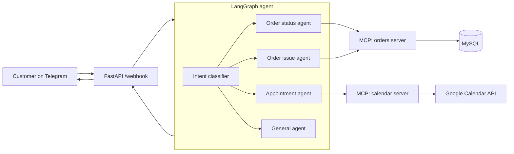

# AI Customer Support Assistant

An AI-powered customer support assistant on **Telegram**. Customers can check order status and delivery updates, report damaged or delayed orders, and book appointments with the support team, all in a normal chat.

Built with **LangGraph** agents that use **Model Context Protocol (MCP)** servers to talk to a **MySQL** order database and **Google Calendar**.

## Features

- **Order status & delivery updates**: look up an order by ID and get status, carrier, tracking and ETA
- **Damaged / delayed order workflows**: creates a support request and routes it to the right team with a priority, using predefined business rules
- **Appointment scheduling**: checks support-team availability in Google Calendar, books a slot and confirms it in chat
- **Intent routing**: a classifier node sends each message to a specialised agent
- **Conversation memory**: per-chat history, so follow-ups like "it's ORD1004" work
- **Functional test scenarios**: a scenario runner that checks the right tool is called for each message

## Architecture



## Tech Stack

Python, GenAI (OpenAI LLM), LangGraph, Model Context Protocol (MCP), FastAPI, Telegram Bot API, MySQL, Google Calendar API

## Project Structure

```
ai-customer-support-assistant/
├── app/
│   ├── main.py             # FastAPI app + Telegram webhook
│   ├── config.py           # env config
│   ├── telegram_client.py  # Telegram send helpers
│   ├── mcp_client.py       # loads MCP tools into LangChain
│   └── agent/
│       ├── graph.py        # LangGraph: classifier + specialised agents
│       └── prompts.py
├── mcp_servers/
│   ├── orders_server.py    # order lookup + issue workflows (MySQL)
│   ├── calendar_server.py  # availability + booking (Google Calendar)
│   └── db.py
├── database/               # schema.sql, seed.sql
├── tests/                  # scenarios.json + run_scenarios.py
├── scripts/cli_chat.py     # test the agent in the terminal
├── requirements.txt
└── .env.example
```

## MCP Tools

| Server | Tool | What it does |
|---|---|---|
| orders | `get_order_status` | Order details by ID |
| orders | `get_delivery_update` | Carrier, tracking, location, ETA, days overdue |
| orders | `report_order_issue` | Creates a support request, routed by business rules |
| calendar | `check_availability` | Free 30-min slots for a date |
| calendar | `book_appointment` | Creates a Google Calendar event |

### Business rules (in `orders_server.py`)

| Issue | Team | Priority |
|---|---|---|
| damaged | returns_team | high |
| delayed | logistics_team | medium (high if 3+ days overdue) |
| wrong_item | returns_team | medium |
| other | general_support | low |

## Setup

**1. Clone and install**
```bash
git clone https://github.com/SSrivarshini/ai-customer-support-assistant.git
cd ai-customer-support-assistant
python -m venv venv && source venv/bin/activate   # Windows: venv\Scripts\activate
pip install -r requirements.txt
```

**2. Database**
```bash
mysql -u root -p < database/schema.sql
mysql -u root -p < database/seed.sql
```

**3. Environment**
```bash
cp .env.example .env    # fill in your keys
```
- Create a Telegram bot with [@BotFather](https://t.me/BotFather) and copy the token
- Google Calendar: create a service account, download its JSON key to `credentials/service_account.json`, and share your support calendar with the service account email (with "Make changes to events")

**4. Try it in the terminal (no Telegram needed)**
```bash
python -m scripts.cli_chat
```

**5. Run the Telegram bot**
```bash
uvicorn app.main:app --port 8000
ngrok http 8000        # expose your local server
curl "https://api.telegram.org/bot<TOKEN>/setWebhook?url=<NGROK_URL>/webhook&secret_token=<TELEGRAM_WEBHOOK_SECRET>"
```
Open your bot in Telegram and send `/start`.

## Example Conversations

```
You: where is my order ORD1002?
Bot: ORD1002 (Bluetooth Speaker) is out for delivery with Delhivery, expected today.

You: my order ORD1003 arrived damaged
Bot: Sorry about that! I've raised request #1 with our returns team (high priority).

You: can I talk to someone tomorrow?
Bot: Sure! Free slots tomorrow: 10:00, 10:30, 11:00 ... Which time works?
```

## Testing

```bash
python -m tests.run_scenarios
```
Runs the scenarios in `tests/scenarios.json` and checks that each message triggers the expected MCP tool. Add more scenarios to the file to grow coverage.

## Future Improvements

- Persistent conversation memory (MySQL/Postgres checkpointer)
- Human handoff and ticket status lookup
- Docker / docker-compose deployment
- Evaluation with LLM-as-judge for response quality

## Author

**Srivarshini S**: [GitHub](https://github.com/SSrivarshini)

## License

MIT
